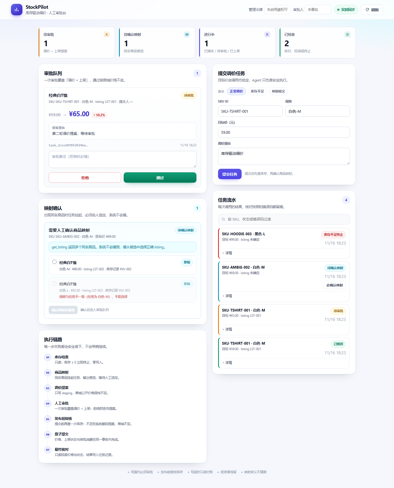

# StockPilot

基于 MCP 的库存驱动电商调价上架 Agent。调用方给定 `sku_id`、规格、目标价和理由，Agent 负责在受约束的链路中安全执行：

```
check_inventory → get_listing → update_price（审批）
→ check_inventory（发布前复核）→ publish_listing → get_listing 核对
```

这不是「让模型自己定价」的 Demo，而是一个把**审批门禁、两阶段提交、超时熔断、映射歧义、重启恢复**都写进代码和测试的受约束执行器。

## 30 秒看懂

```bash
./.venv/Scripts/python.exe -m stock_pilot.demo          # 初始化演示库并启动审批台
# 浏览器打开 http://127.0.0.1:8000/
```

一条命令启动 API、种入演示数据并打印三个用例（正常调价 / 库存不足 / 映射歧义）。
加 `--split` 会同时拉起库存与商城两个 HTTP MCP Server；`--fresh` 只重建演示库。



页面左侧是审批队列、映射确认与执行链路；右侧提交任务并查看任务流水。截图对应：
一次已通过的调价（¥59）、一个等待审批的第二轮提案（¥65）、一个因同名商品挂起的
映射任务，以及一个库存为零直接终止的任务。

## 安全保证

| 规则 | 实现 |
|---|---|
| 库存 ≤ 0 | 在 `check_stock` 终止，审批、staging、商城写入均为零 |
| 审批期间库存归零 | 审批通过后、提交前再查一次库存；不足则系统撤回提案（`abandoned`），丢弃 staging，任务回滚 |
| 复核与提交之间库存变化 | `publish_listing` 在提交事务内重新校验库存；不足则整个事务回滚，商城零写入 |
| 商品映射歧义 | `get_listing` 返回候选列表，LangGraph `interrupt` 挂起，必须人工选定，禁止猜测 |
| 写操作必须审批 | `update_price` 只写 staging + 审批记录；商城公开价格在审批通过前不变 |
| 审批拒绝零残留 | 拒绝时丢弃 staging；商城侧从未发生写入 |
| 写超时 | 只做一次只读 `get_listing` 对账；对账失败进入 `ABORTED_UNKNOWN_STATE`，绝不重发写操作 |
| 进程中断 | 重启后 `GET /recovery` 显式列出异常态；已审批提案可安全恢复，未审批任务沿用原流程 |
| 重复请求 | `Idempotency-Key` 保证 `POST /tasks` 不重复建任务；重复审批返回当前结果 |
| 操作人身份 | 配置 Token 后写接口按角色校验；`decided_by` / `abandoned_by` 取自身份，不信任请求体 |
| 并发写 | `BEGIN IMMEDIATE` 单写事务 + 部分唯一索引：每个 listing 只有一个活跃提案；审批只消费一次 |
| 审批人 ≠ 提交人 | agent 与 operator 角色分离；admin 为 break-glass，自审会在日志与 `submitted_by == decided_by` 中暴露 |

## 架构

```
                    ┌──────────────────────────────┐
                    │  原生 HTML/CSS/JS 审批台      │
                    │  待审批 / 映射 / 恢复 / 流水   │
                    └──────────────┬───────────────┘
                                   │ HTTP
                    ┌──────────────▼───────────────┐
                    │ FastAPI                       │
                    │ 提交 / 审批 / 映射 / 恢复      │
                    └──────────────┬───────────────┘
                                   │
                    ┌──────────────▼───────────────┐
                    │ LangGraph 状态机              │
                    │ check → map → stage → gate    │
                    │   → recheck → publish → verify│
                    └──────────────┬───────────────┘
                                   │ ToolClient
                    ┌──────────────▼───────────────┐
                    │ MCPToolClient (stdio)         │
                    │ 超时 / 读重试 / 写一次 / 熔断 │
                    └──────────────┬───────────────┘
                                   │ MCP
                    ┌──────────────▼───────────────┐
                    │ MCP Server（4 个工具）         │
                    └──────────────┬───────────────┘
                                   │
                    ┌──────────────▼───────────────┐
                    │ SQLite（WAL）                 │
                    │ inventory / listings /        │
                    │ staging / approvals / tasks   │
                    └──────────────────────────────┘
```

- `STOCK_PILOT_TOOL_CLIENT=inprocess`（默认）：工具在编排进程内执行，便于测试。
- `STOCK_PILOT_TOOL_CLIENT=mcp`：四个工具真实走 MCP stdio，客户端自动拉起 Server 子进程。
- `STOCK_PILOT_TOOL_CLIENT=mcp-http`：库存与商城拆成两个独立 MCP Server（Streamable HTTP），客户端按工具路由到对应服务，携带 `STOCK_PILOT_AGENT_TOKEN`。
- 审批队列读写与决策留在编排进程本地，因为审批台是人机管理面，不属于四个 MCP 工具。

**鉴权（B1）**：`STOCK_PILOT_AGENT_TOKEN` / `STOCK_PILOT_OPERATOR_TOKEN` / `STOCK_PILOT_ADMIN_TOKEN` 配置静态 Bearer Token。任一 Token 存在即启用校验：提交任务需 agent（admin 亦可），审批、映射确认、恢复、撤回需 operator（admin 亦可）；带身份时 `decided_by` / `abandoned_by` 取自身份，忽略请求体伪装。只读接口默认保持开放以便演示；设置 `STOCK_PILOT_REQUIRE_READ_AUTH=true` 后，`GET /tasks|/approvals|/recovery` 也要求任一有效 Token（`/healthz` 始终开放供探针使用）。两个 HTTP MCP Server 同样只接受 agent Token。审批台的「管理令牌」输入框会附带 Bearer 头（存于 sessionStorage，关闭标签页即失效），填入 admin Token 即可在启用鉴权时操作全流程。未配置任何 Token 时保持本地演示模式。

**两阶段提交**：`update_price` 在同一事务里写 `staging` 和 `approvals`，商城不可见；审批通过后 `publish_listing` 在同一事务内完成「改价 + 上架 + 消费审批」。因此不存在「价格已改但未上架」的中间脏状态。

**发布前复核**：审批可能持续数小时，库存不是审批时的快照。图在 `await_approval` 与 `publish` 之间增加 `recheck_stock`：库存不足、记录消失或复核工具失败时，系统不提交，而是把审批标记为 `abandoned` 并在同一事务里丢弃 staging；任务进入 `ROLLED_BACK`（库存不足）或 `ABORTED_UNKNOWN_STATE`（无法确认）。`abandoned` 不是人工拒绝，审计上区分开。

**重启恢复**：`GET /recovery` 只读扫描中断态任务（已审批未提交、已拒绝/系统撤回未关闭、已提交未核对），以及写超时后遗留的 `price_staged` 提案。可自动继续的任务由 `POST /tasks/{id}/recover` 从图 checkpoint 恢复：已审批的任务继续走发布链路，已提交的任务只补做最终只读核对（绝不重复发布）。遗留提案只标注、不自动写；人工确认后可用 `POST /approvals/{id}/abandon` 撤回，该接口会先做一次只读对账，商城已提交则拒绝撤回。

**健康检查**：`GET /healthz` 返回数据库连通性、工具客户端可用性、待审批数与恢复问题数；数据库或工具客户端不可用时返回 `503` 与 `status=degraded`，部署层据此摘流量，避免在工具不可用时接收新的写任务。

**观测性（E2）**：`GET /metrics` 输出 Prometheus 指标（任务状态、工具尝试与耗时、审批积压、恢复问题、熔断、工具客户端可用性），与 `/healthz`、`tool_events` 同源。设置 `STOCK_PILOT_LOG_FORMAT=json` 后每次工具尝试输出一行结构化日志（含 `task_id`、工具、结果、耗时，不含 Token）。MCP 客户端每 2 秒 ping 一次，断线后以 0.5s→10s 指数退避自动重连；重连只恢复传输，绝不重放写操作。指标含义、告警规则与日志字段见 `docs/observability.md`。

## 快速开始

Windows Git Bash：

```bash
python -m venv .venv
./.venv/Scripts/python.exe -m pip install -e ".[dev]"

# 一条命令：建库 + 启动审批台（默认进程内模式）
./.venv/Scripts/python.exe -m stock_pilot.demo
# 浏览器打开 http://127.0.0.1:8000/；加 --split 使用两个 HTTP MCP Server

# 只启动 API
./.venv/Scripts/python.exe -m stock_pilot.api

# 真实 MCP stdio 模式
STOCK_PILOT_TOOL_CLIENT=mcp ./.venv/Scripts/python.exe -m stock_pilot.api

# B1：库存 / 商城两个 HTTP MCP Server + 编排进程
export STOCK_PILOT_AGENT_TOKEN=demo-agent-token
export STOCK_PILOT_OPERATOR_TOKEN=demo-operator-token
./.venv/Scripts/python.exe -m stock_pilot.mcp_inventory &   # 127.0.0.1:8101/mcp
./.venv/Scripts/python.exe -m stock_pilot.mcp_mall &        # 127.0.0.1:8102/mcp
STOCK_PILOT_TOOL_CLIENT=mcp-http ./.venv/Scripts/python.exe -m stock_pilot.api

# 结构化日志（默认 text；json 便于采集）
STOCK_PILOT_LOG_FORMAT=json ./.venv/Scripts/python.exe -m stock_pilot.api

# 全量回归
./.venv/Scripts/python.exe -m pytest -q
```

POSIX 把 `./.venv/Scripts/python.exe` 换成 `.venv/bin/python` 即可。

## 演示脚本

1. **正常调价**：提交 `SKU-TSHIRT-001` / `白色-M` / `59.00` → 审批队列出现提案 → 通过 → 任务 `verified`，商城 59 元且已上架，最终核对一致。
2. **库存不足**：提交 `SKU-HOODIE-003` / `黑色-L` → 任务 `aborted_no_stock`，审批队列为空，商城零写入。
3. **映射歧义**：提交 `SKU-AMBIG-002` / `白色-M` → 任务挂起，显示两个候选 → 人工选 `LST-002` → 进入审批 → 通过 → 核对。
4. **审批拒绝**：任意正常提案 → 拒绝并填写原因 → 任务 `rolled_back`，staging 丢弃，商城价格不变。
5. **审批期间库存归零**：提交提案后把 `inventory_records.quantity` 改为 0，再审批通过 → 任务 `rolled_back` / `INSUFFICIENT_STOCK`，审批 `abandoned`，staging 丢弃，商城不变。
6. **重启恢复**：提交提案后重启 API → 原任务仍在队列，审批后正常完成。模拟「已决策未恢复」后，页面出现「待恢复任务」面板，点击「恢复执行」完成后续步骤；模拟「已提交未核对」则只补做只读核对。
7. **重复提交**：带相同 `Idempotency-Key` 连续提交两次，只产生一个任务和一条审批。
8. **遗留提案清理**：写超时遗留的 `staging_orphaned` 在恢复面板显示「撤回遗留提案」；接口先只读对账，商城已按提案提交时返回 `409`，不会误删。

## API

| 方法 | 路径 | 说明 |
|---|---|---|
| `POST` | `/tasks` | 提交任务；可选 `Idempotency-Key` 请求头 |
| `GET` | `/tasks?limit=100` | 任务流水 |
| `GET` | `/tasks/{id}` | 任务详情 |
| `GET` | `/tasks/{id}/events` | 工具调用时间线（每次尝试的结果与耗时） |
| `POST` | `/tasks/{id}/mapping` | 确认歧义商品的候选 listing |
| `POST` | `/tasks/{id}/recover` | 恢复「已决策但未继续」的任务 |
| `POST` | `/approvals/{id}/decision` | 审批：`approve` / `reject`，可带 `note` 与 `decided_by` |
| `POST` | `/approvals/{id}/abandon` | 人工撤回遗留提案；先只读对账，商城已提交则拒绝 |
| `GET` | `/approvals` | 审批记录，可按状态过滤 |
| `GET` | `/approvals/queue` | 审批台联表队列（商品 + 任务上下文） |
| `GET` | `/approvals/{id}` | 单条审批详情 |
| `GET` | `/recovery` | 只读重启对账结果 |
| `GET` | `/healthz` | 就绪检查；不可用时 `503` + `status=degraded` |
| `GET` | `/metrics` | Prometheus 文本格式指标（不做鉴权，供抓取） |

审批决策是幂等的：重复提交相同决策返回当前任务；提交相反决策返回 `409`。

配置了 Token 时：`POST /tasks` 需 agent（或 admin）；`POST /tasks/{id}/mapping`、`POST /tasks/{id}/recover`、`POST /approvals/{id}/decision`、`POST /approvals/{id}/abandon` 需 operator（或 admin）。缺少 / 错误 Token 返回 `401`，角色不足返回 `403`。`STOCK_PILOT_REQUIRE_READ_AUTH=true` 时只读接口也要求有效 Token。

## 失败语义

| 错误码 | 任务终态 | 后续写操作 |
|---|---|---|
| `INSUFFICIENT_STOCK`（任务开始时） | `ABORTED_NO_STOCK` | 禁止 |
| `INSUFFICIENT_STOCK`（发布前复核） | `ROLLED_BACK` | 禁止，审批 `abandoned`，staging 已丢弃 |
| `INSUFFICIENT_STOCK`（提交事务内复查） | `ROLLED_BACK` | 事务回滚，商城零写入，审批 `abandoned` |
| `MAPPING_AMBIGUOUS` | `SUSPENDED_AMBIGUOUS` | 等待人工映射 |
| `APPROVAL_REJECTED` | `ROLLED_BACK` | 禁止，staging 已丢弃 |
| `TOOL_TIMEOUT` / `TOOL_UNAVAILABLE` / `CIRCUIT_OPEN`（写） | 一次只读对账；失败则 `ABORTED_UNKNOWN_STATE` | 禁止重发 |
| `PENDING_APPROVAL_EXISTS` | `ABORTED_FAILED` | 禁止抢占其他任务的提案 |
| `FAILED_VERIFICATION` | `FAILED_VERIFICATION` | 保留现场等待人工核查 |

## 测试

```bash
./.venv/Scripts/python.exe -m pytest -q          # 93 个用例
./.venv/Scripts/python.exe -m pytest tests/test_recovery.py -q
./.venv/Scripts/python.exe -m ruff check src tests
```

- `tests/test_tools_acceptance.py`：四条验收用例的工具层断言 + MCP 工具注册。
- `tests/test_agent_acceptance.py`：图编排、映射恢复、写超时对账、拒绝/超时后零后续写。
- `tests/test_runner.py`：超时重试、熔断、写不重试、业务失败不计入熔断。
- `tests/test_api.py`：FastAPI 操作接口、错误码与就绪检查。
- `tests/test_ui.py`：审批台静态资源、队列联表、恢复入口与遗留提案清理。
- `tests/test_mcp_client.py`：真实 MCP stdio 全链路、API/MCP 模式、服务不可用或中途退出时安全终止。
- `tests/test_mcp_http.py`：两个 Streamable HTTP MCP Server 的工具路由、完整图链路、Bearer 校验与未授权时安全终止。
- `tests/test_auth.py`：角色鉴权、跨角色拒绝、身份覆盖请求体、撤回操作人留痕、只读鉴权开关、admin 自审告警。
- `tests/test_concurrency.py`：并发 staging 只产生一个提案、相反审批只有一个生效、并发发布只提交一次、相同 `Idempotency-Key` 并发提交只建一个任务、并发初始化同一演示库只 seed 一次。
- `tests/test_recovery.py`：进程重启、幂等提交、审批幂等、操作者身份、工具时间线、恢复接口（含已提交任务只读核对）、发布前与事务内库存复核、遗留提案撤回。
- `tests/test_observability.py`：`/metrics` 数值（任务、工具事件、耗时、熔断、降级）、JSON 日志字段与 `task_id`、白名单（Token 不入日志）、`/healthz` 降级。
- `tests/test_reconnect.py`：HTTP MCP Server 停机 → 任务安全中止 → 同端口重启 → 自动重连 → 新任务完成，审计中只有一次成功 `publish_listing`。

## 目录

```
src/stock_pilot/
  db.py           SQLite schema / 事务 / 演示数据 / 增量迁移
  models.py       Pydantic 契约（工具与 API）
  inventory.py    库存模块
  mall.py         商城模块（get_listing / update_price / publish_listing）
  approval.py     审批模块（人机管理面）
  tools.py        进程内工具门面
  clients.py      ToolClient 边界 + stdio / 拆分 HTTP 客户端
  runner.py       超时 / 重试 / 熔断 / 审计事件
  audit.py        工具调用时间线
  metrics.py      Prometheus 指标（从 SQLite 与执行器派生）
  logging_config.py JSON / 文本日志配置
  auth.py         静态 Bearer Token 与角色
  recovery.py     只读重启对账
  demo.py         一条命令启动演示（可选拆分拓扑）
  agent.py        LangGraph 状态机
  api.py          FastAPI + 静态审批台
  mcp_server.py   MCP 工具注册（单 Server / 拆分 Server 共用）
  mcp_http.py     Streamable HTTP + Bearer 中间件
  mcp_inventory.py 库存 MCP Server（HTTP）
  mcp_mall.py      商城 MCP Server（HTTP）
  static/         零构建审批台
tests/            验收、单元、API、UI、MCP、鉴权、恢复
```

## 文档

- `docs/demo.md`：约 8 分钟的面试演示脚本，含失败路径与拆分/鉴权演示。
- `docs/screenshots/console.png`：审批台截图（演示数据：待审批 / 映射歧义 / 已核对 / 库存终止）。
- `docs/observability.md`：指标、告警规则、结构化日志与断线重连语义。
- `docs/adr/`：两阶段提交、失败语义、拆分与鉴权、恢复与人工清理的决策记录。

## 设计取舍与生产化

第一版刻意保持单 SQLite、单 MCP Server，用 module 边界隔离库存 / 商城 / 审批，便于在本地演示完整闭环和故障路径。B1 已把库存与商城拆成两个独立的 Streamable HTTP MCP Server，并加上静态 Token 角色鉴权；审批面按决策留在编排进程，因为它是人机管理面而非模型工具。

生产化继续拆分方向：

1. 两个工具 Server 各自持有独立数据库与服务间鉴权；当前演示仍共享同一个 SQLite 文件。
2. Postgres 替换 SQLite；跨服务提交从单库事务改为 saga / 补偿，明确每一步的一致性边界。
3. 静态 Token 换成 OIDC / 真实登录；只读鉴权已可通过 `STOCK_PILOT_REQUIRE_READ_AUTH` 开启，生产再接入统一网关。
4. 指标与结构化日志已落地（Prometheus `/metrics`、JSON 日志）；生产再接入告警平台、日志聚合与审批审计导出。

已知限制：共享 SQLite 适合单实例演示，拆分 Server 只是拓扑演练；静态 Token 没有轮换与细粒度权限；admin 自审只告警不阻断（正常流程由角色分离保证审批人 ≠ 提交人）。
